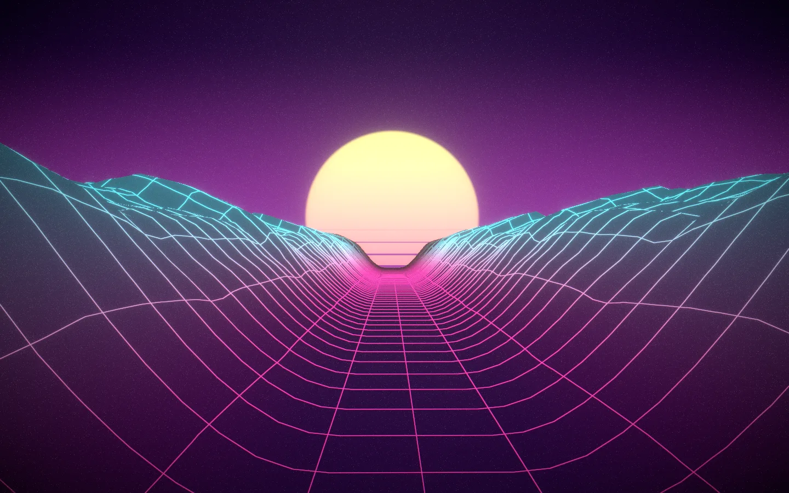
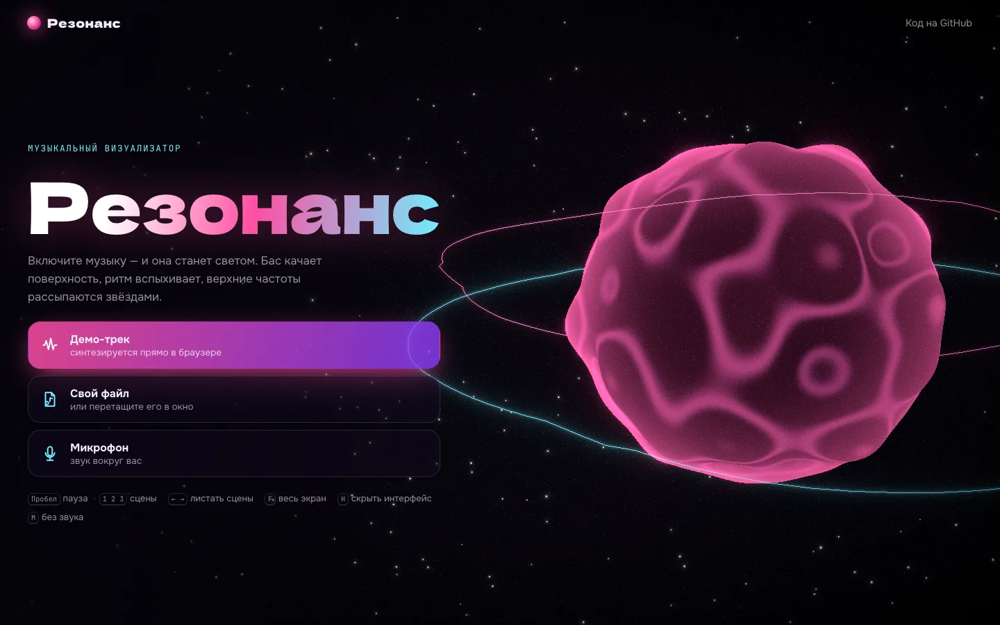
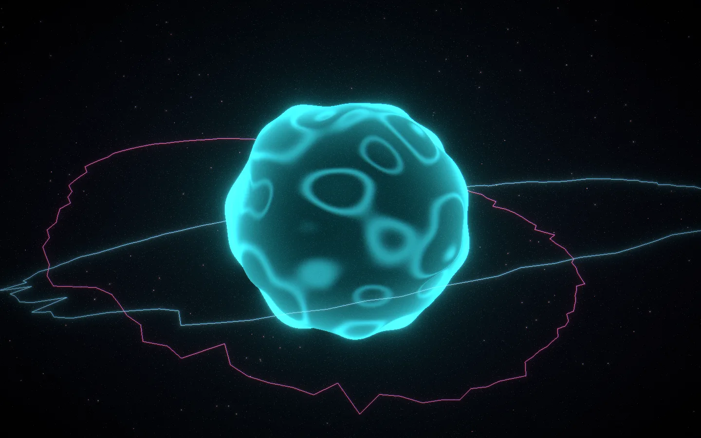
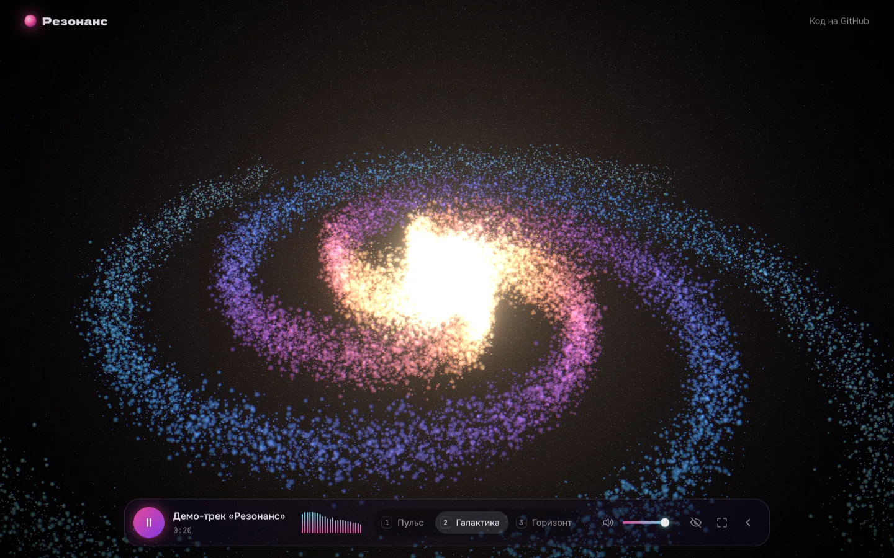
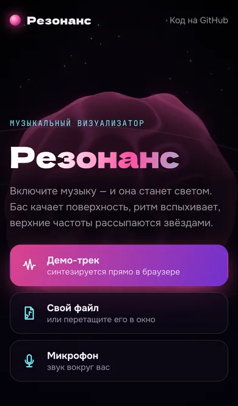
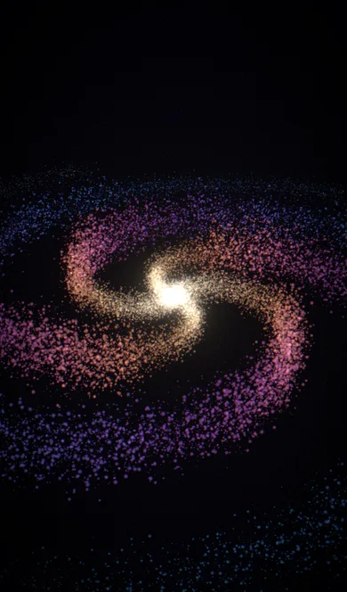

<div align="center">

<a href="https://dmitriy9427.github.io/resonance/"></a>

# 🔊 Резонанс

**Музыкальный визуализатор: три 3D-сцены, которые слушают музыку — пет-проект на React Three Fiber**

### [Открыть демо →](https://dmitriy9427.github.io/resonance/)

      [](https://github.com/dmitriy9427/resonance/actions/workflows/pages.yml)

</div>

| Старт | «Пульс» | «Галактика» |
| --- | --- | --- |
|  |  |  |

## Коротко

| | |
| :---: | --- |
| 🎛 | **Звук → свет** — бас качает поверхность, ритм вспыхивает, верхние частоты рассыпаются звёздами |
| 🎹 | **Демо-трек без файлов** — синтезируется в браузере из осцилляторов и шума: бочка, бас, пэды, арпеджио |
| 🎧 | **Свой файл или микрофон** — кнопкой или перетаскиванием в окно |
| 🌌 | **Три сцены на шейдерах** — сфера на шуме, галактика из 60 000 частиц, синтвейв-ландшафт из истории спектра |
| ⚡ | **60 fps** — вся тяжёлая математика на видеокарте, уровни звука в обход React |
| 📚 | **Обучающая документация** — от «что такое спектр» до шейдеров, в [docs/](docs/README.md) |

Автор — [Дмитрий Рябов](https://dmitriy9427.github.io/resume/), frontend-разработчик.

---

## Сцены

- **Пульс** — сфера, поверхность которой колышет simplex-шум; амплитуду задаёт
  бас, мелкую рябь — верхние частоты, толчок — доля. Края светятся (эффект
  Френеля), вокруг — два кольца-спектра. Цвета сменяются каждые 16 долей.
- **Галактика** — 60 000 звёзд в спиральных рукавах. Каждая привязана к своей
  полосе спектра по радиусу: ядро — басы, окраины — верха. Громкие полосы
  выталкивают свои звёзды из диска.
- **Горизонт** — ретро-ландшафт: каждая строка гор — снимок спектра, снимки
  едут к зрителю, рельеф — история музыки за последние секунды. Солнце дышит в
  такт громкости трека.

## Управление

`Пробел` — пауза · `1` `2` `3` — сцены · `←` `→` — листать · `F` — весь экран ·
`H` — скрыть интерфейс · `M` — без звука. Во время музыки интерфейс прячется сам
через 3 секунды покоя. На телефоне всё то же — кнопками с подписями.

| Телефон: старт | Телефон: «Галактика» |
| --- | --- |
|  |  |

## Как устроено

Подробно и с объяснениями для новичков — в [docs/](docs/README.md):
[архитектура](docs/01-architecture.md) ·
[звук в браузере](docs/02-web-audio.md) ·
[демо-трек из кода](docs/03-synth.md) ·
[React Three Fiber](docs/04-r3f.md) ·
[шейдеры](docs/05-shaders.md) ·
[свечение и производительность](docs/06-post-and-perf.md).

## Стек

React 19 · TypeScript · three.js · React Three Fiber · drei · postprocessing ·
GLSL · Web Audio API · Zustand · Vite · Vitest.

## Запуск

```bash
npm install
npm run dev      # http://localhost:5191
npm run check    # линтер, типы, тесты, сборка
```
