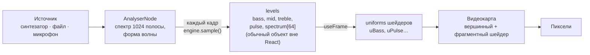

# 00. С чего начать

Этот учебник для человека, который знает React, но никогда не работал со **звуком в браузере**
(Web Audio API), **3D** (three.js, React Three Fiber) и **шейдерами**. «Резонанс» — три 3D-сцены,
которые слушают музыку: демо-трек, ваш файл или микрофон.

## Как устроена каждая глава

1. **Зачем** — что видит и слышит человек.
2. **Как это выглядит** — маленький пример.
3. **Как это сделано в «Резонансе»** — настоящий код с разбором.
4. **Ошибки** — что ломается у всех в первый раз.
5. **Попробуйте сами** — задания с ответами под спойлером.

## Картинка целиком: путь звука до пикселя за один кадр

Три идеи, на которых всё держится:

1. **60 раз в секунду — без React-состояния.** Уровни громкости меняются каждый кадр. Положи их
   в `useState` — React перерисовывал бы компоненты 60 раз в секунду. Поэтому `levels` — обычный
   изменяемый объект: звук пишет в него, сцены читают в `useFrame`.
2. **Сырой спектр нельзя показывать как есть.** Он дёргается, басы занимают пару ячеек из тысячи,
   громкость трека всё меняет. Между анализатором и картинкой — обработка: полосы, логарифм,
   сглаживание «быстро вверх — медленно вниз», детектор долей.
3. **Тяжёлую работу делает видеокарта.** десятки тысяч вершин сферы двигает шейдер; JS передаёт ему
   только несколько чисел.

## Словарь в одну строку

| Слово | Простыми словами | Пример в проекте |
| --- | --- | --- |
| **AudioContext** | «Звуковая студия» браузера: все узлы звука живут в ней | `engine.ts` |
| **Узел (node)** | Блок обработки звука: источник, громкость, анализатор | `GainNode`, `AnalyserNode` |
| **Граф** | Как узлы соединены: источник → анализатор → динамики | `input.connect(analyser)` |
| **Спектр** | Сколько в звуке каждой частоты прямо сейчас | `getByteFrequencyData` |
| **FFT** | Математика, которая раскладывает звук на частоты | `fftSize = 2048` |
| **Полоса частот** | Диапазон: бас 20–150 Гц, середина, верха | `BANDS` |
| **RMS** | Средняя громкость по форме волны | `rms(waveform)` |
| **Attack / release** | Как быстро значение растёт / падает | `follow(prev, next, 0.6, 0.12)` |
| **Доля (beat)** | Удар бочки — всплеск баса | `BeatDetector` |
| **React Three Fiber** | three.js в виде React-компонентов | `<mesh>`, `<Canvas>` |
| **`useFrame`** | Функция, которую R3F зовёт каждый кадр | анимация сцены |
| **Шейдер** | Программа для видеокарты | `vertex`, `fragment` в `Sphere.tsx` |
| **Uniform** | Число, которое JS передаёт шейдеру | `uBass`, `uPulse` |
| **Вершинный шейдер** | Где находится каждая точка | волны на сфере |
| **Фрагментный шейдер** | Какого цвета каждый пиксель | светящиеся края |
| **Шум (noise)** | Плавная «случайность» для природных форм | `snoise` |
| **Постобработка** | Эффекты поверх готового кадра | свечение (Bloom), зерно |
| **DPR** | Сколько пикселей экрана на один пиксель CSS | снижаем на слабых устройствах |

## Как читать код проекта

- **Комментарий в начале каждого файла** — «зачем» и «почему так».
- **`src/audio/analysis.ts`** — чистые функции без Web Audio, проверяются тестами на массивах.
- **Не нашли, где что-то делается?** Ищите по названию сцены: «Пульс» → `scenes/Sphere.tsx`.

## Порядок чтения

| Если вы хотите… | Читайте |
| --- | --- |
| понять, как всё связано | [01. Архитектура](01-architecture.md) |
| звук и спектр с нуля | [02. Web Audio](02-web-audio.md) |
| демо-трек без файлов | [03. Синтезатор](03-synth.md) |
| 3D в React | [04. React Three Fiber](04-r3f.md) |
| шейдеры | [05. Шейдеры](05-shaders.md) |
| свечение и 60 fps | [06. Постобработка и скорость](06-post-and-perf.md) |
| понять конкретный файл | [Разбор кода](code/README.md) |
